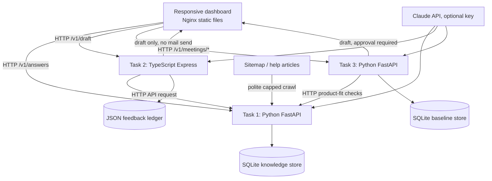

# Design — AI Tech Consultant

## 1. Problem and product decisions

The capstone joins three workflows that normally require separate manual work: finding product answers, replying to customer email, and converting client meetings into implementation scopes. The core business risk is not typing speed. It is inaccurate information, missing requirements, unsupported promises, and unreviewed actions reaching a customer.

This repository starts with a minimal demonstrable version of the three workflows. It is a capstone prototype, not a production-certified service. In particular, the current Knowledge Brain uses SQLite and lexical retrieval; it does not yet have vector embeddings, a vector index, or full screenshot interpretation.

### Features included in this version

- Knowledge Brain HTTP API with source excerpts, a cautious lexical-match threshold, abstention, escalation records, expert-answer provenance, and a capped polite sitemap crawler.
- Inbox Agent API written in strict TypeScript. It calls Task 1 over HTTP, classifies common intent and risk, drafts replies, records feedback, and tracks consecutive unchanged drafts by category and prompt version.
- Meeting-to-Scope API written in Python. It runs distinct requirement extraction, product-fit lookup, estimate and proposal stages; each product-fit lookup calls Task 1 through HTTP.
- A responsive static dashboard for trying each path; explicit human-review boundaries for emails and proposals.
- Persistent SQLite state for knowledge and meeting baselines, plus a persisted JSON feedback ledger for the Inbox Agent.
- Sixty acceptance/regression scenarios in `evals/cases.json`.

### Features deliberately not represented as complete

- Semantic/vector retrieval and a knowledge graph.
- Automated screenshot/image understanding. Article image URLs and alt text are retained, but the image pixels are not yet interpreted.
- Complete sitemap inventory reconciliation and safe deletion of removed articles. The current ingestion is capped and explicitly avoids inferring deletions.
- A scheduled daily ingestion worker.
- A real email provider integration. Task 2 drafts only and never sends.
- A polished authenticated multi-user admin console, production deployment, end-to-end CI, and fully executed model comparisons.

These omissions are visible because a smaller, honest prototype is easier to review than fabricated completeness.

## 2. Architecture

Tasks 2 and 3 consume Task 1 through the documented HTTP contract. They do not import Task 1 code. The Compose file runs the services on ports 8001, 8002, and 8003; the Nginx dashboard is on port 8080.

## 3. Service contracts

### Task 1 — Knowledge Brain (Python)

- `GET /health` — readiness probe.
- `GET /v1/documents` — view indexed records and article image references.
- `POST /v1/ingest` — politely fetch a capped number of pages from the configured sitemap. The URL host is restricted. A per-article upsert makes repeated runs idempotent and restart-friendly.
- `POST /v1/answers` — returns an answer, citation title/URL/excerpt, image URLs, a knowledge version label, model name, latency and usage when supplied by the provider.
- `GET /v1/escalations` and `POST /v1/expert-answers` — human escalation list and reviewed answer ingestion.

Retrieval currently ranks documents by lexical token overlap. A low match yields an explicit abstention and escalation. If the Anthropic key is absent or model call fails, the answer path exposes retrieved text instead of pretending Claude answered. The returned citations identify retrieved documents; they are not proof that a generated sentence is entailed by each citation, so citation-faithfulness evaluation is still required.

### Task 2 — Inbox Agent (TypeScript)

- `GET /health`
- `POST /v1/draft` — validates sender, subject and body; classifies intent/risk; calls Task 1; creates a draft and returns sources and review status.
- `POST /v1/feedback` and `GET /v1/feedback/streaks` — records sent, edited, replaced or rejected outcomes and tracks the unchanged streak for category + workflow version.
- `POST /v1/autonomy/:category/enable` — intentionally returns 403. An eligible category is not permission to send. Real mailbox credentials, authorization, audit controls and a revoke path are not implemented.

Formatting normalization trims outer whitespace and trailing spaces and normalizes CRLF line endings. Only a human-sent reply with normalized subject and body identical to the draft increments the streak. All other outcomes reset it.

### Task 3 — Meeting to Scope (Python)

- `GET /health`
- `POST /v1/meetings/process` — extracts requirements with transcript evidence, checks product fit through Task 1, estimates tasks, and drafts scope and proposal.
- `POST /v1/meetings/compare` — compares a follow-up transcript against a saved baseline and requires human approval.
- `GET /v1/meetings/baselines` — lists saved baseline identifiers.

The workflow's roles are explicit but sequential. When the Claude API is not configured or returns unusable JSON, labelled deterministic fallbacks are used. The fallback estimate of 2–8 hours per requirement is a placeholder, not a validated estimate. Pricing is only arithmetic from an explicitly supplied rate and currency; no rate is invented.

## 4. Safety and reliability boundaries

- Retrieved pages, email text, and transcript content are untrusted inputs, not instructions for the system.
- Email drafts and proposals do not go to customers automatically.
- Refund, cancellation, complaint, quote and uncertain cases require review.
- An incomplete sitemap fetch does not deactivate the entire knowledge base. Since current ingestion is capped, it does not claim to discover removals.
- The crawler restricts URL scheme and host and uses a one-request-at-a-time rate gate with bounded retries. The first request settings are conservative defaults, not a published server capacity guarantee.
- Secrets come from environment variables. `.env` is excluded from Git.
- The dashboard CORS policy is restricted to the local dashboard origin. Do not deploy it publicly without authentication, CSRF/origin review, rate limiting, and production secret management.

## 5. Run and verify

1. Copy `.env.example` to `.env`.
2. Add an Anthropic API key only in the local ignored `.env` file if model-backed paths are to be tested.
3. Run `docker compose up --build`.
4. Open `http://localhost:8080`; API documentation is exposed at `http://localhost:8001/docs` and `http://localhost:8003/docs`.
5. Inspect actual service logs, exercise a supported and unknown knowledge question, draft an email, process a transcript, and compare a follow-up transcript.

This repository was edited through GitHub's connected file API in this conversation. That does not establish that the container images build or the tests pass. Run and record the checks locally before submission.

## 6. Next steps, prioritized

1. **Make the baseline reliable:** add repeatable automated tests, resolve any dependency/build errors, and run a clean checkout using Docker Compose.
2. **Complete Knowledge Brain requirements:** screenshot vision processing, embeddings/vector or hybrid retrieval, a complete successful sitemap inventory, safe removed-article reconciliation, and a durable daily scheduler.
3. **Add evidence-led evaluation:** score citations, abstentions, email safety and scope coverage on held-out cases; compare two Claude models with identical inputs and record cost and latency.
4. **Harden the product:** authentication and role permissions, rate limits, audit logs, migration management, mailbox provider adapter, backup/restore and deployment controls.
5. **Improve the UI only after the flows are reliable:** structured result panels, source inspection, explicit approval controls and useful error recovery.
